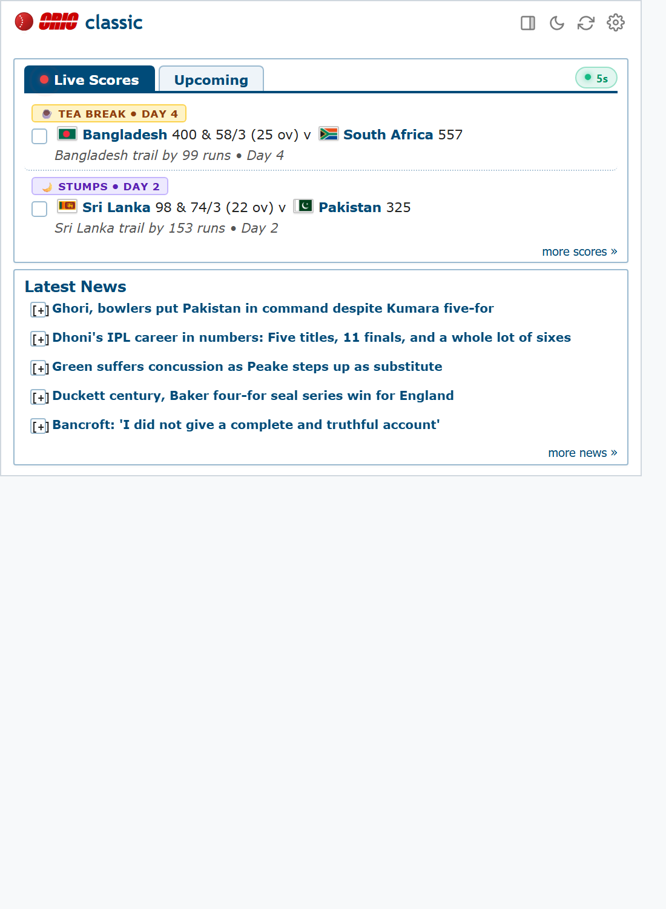
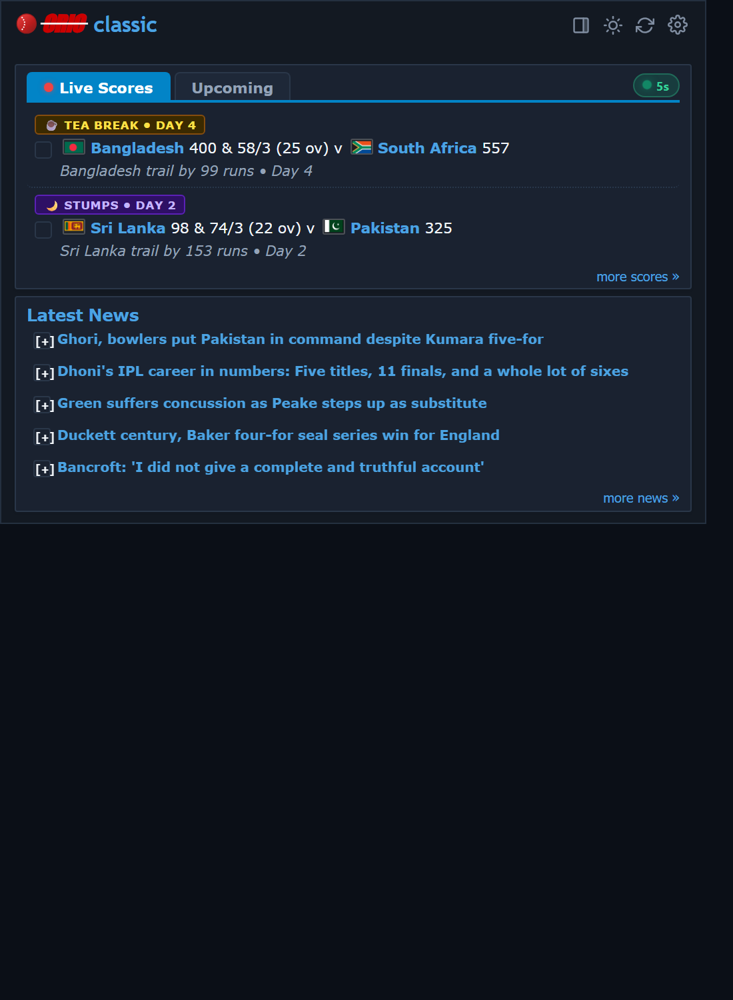
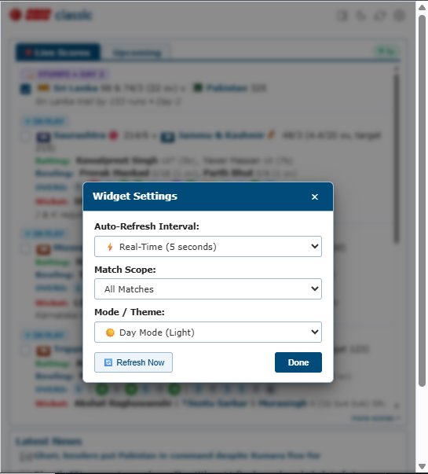

# Classic Cricket Scores Extension

A retro-styled browser extension for Chrome and Firefox providing real-time live cricket scores, recent ball tracker, commentary highlights, bowling partner figures, and upcoming match schedules.

---

## Screenshots

| Day Mode | Night Mode (Dark) | Widget Settings |
| :---: | :---: | :---: |
|  |  |  |

---

## Features

- **Real-Time Live Scores**: Live scorecards with automatic updates (configurable refresh rate from 5s to 30s).
- **13-Ball Sliding Over Tracker**: Shows the last 13 deliveries with over dividers. The most recent delivery is highlighted with a distinct background and bold typography.
- **Color-Coded Deliveries**:
  - Wickets: Red (`#ff4538`)
  - Boundaries (Fours): Green (`#2fa848`)
  - Maximums (Sixes): Purple (`#9254de`)
  - Dot balls & singles: Neutral tones
- **Ball-by-Ball Commentary Hover**: Hover over any delivery bubble to inspect ball commentary details in a floating tooltip.
- **Bowling Partnership Display**: View active bowler statistics alongside their bowling partner (overs, runs, wickets).
- **Recent Dismissal Information**: Displays details of the most recent wicket falling with batter and bowler names.
- **Chrome Side Panel Integration**: Header button opens the extension in Chrome's native side panel with a responsive layout.
- **Upcoming Fixtures**: Schedule view with dates and match start countdowns.
- **Cricket Headlines**: Expandable headlines with interactive toggles.
- **Day & Night Themes**: One-click toggle between classic light theme and modern dark mode.
- **Manifest V3 Architecture**: Built using Manifest V3 standards with local caching for instant launch without delay.

---

## Installation

### Google Chrome / Chromium Browsers
1. Clone or download this repository.
2. Open Chrome and navigate to `chrome://extensions`.
3. Enable **Developer mode** using the toggle in the top-right corner.
4. Click **Load unpacked** and select this directory.
5. Pin the extension to your browser toolbar.

### Mozilla Firefox
1. Open Firefox and navigate to `about:debugging#/runtime/this-firefox`.
2. Click **Load Temporary Add-on...**
3. Select `manifest.json` from the repository directory.

---

## Project Structure

```text
├── assets/                # Real-time UI screenshots for documentation
│   ├── screenshot-light.png
│   ├── screenshot-dark.png
│   └── screenshot-settings.png
├── icons/                 # Extension icons (16, 48, 128, 512 px)
├── popup/
│   ├── popup.html         # Main extension popup interface
│   ├── popup.css          # Classic styling and dark mode rules
│   ├── popup.js           # Score parsing, UI updates, and sliding ball logic
│   ├── sidepanel.html     # Side panel redirect loader
│   └── fallback-data.js   # Offline fallback dataset
├── manifest.json          # Manifest V3 extension configuration
├── service-worker.js      # Background alarms and notification handler
└── README.md
```

---

## License

MIT License. Open-source fan tribute project.
